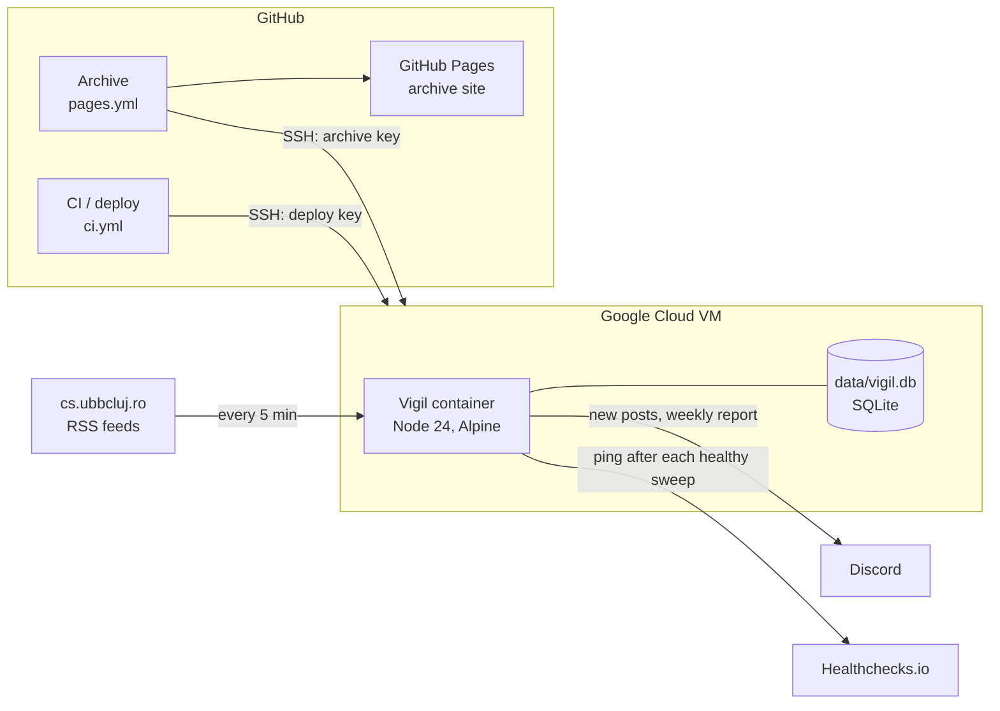
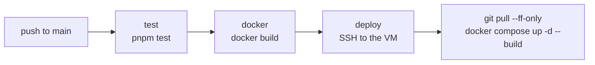

# Vigil


Vigil watches the UBB FMI practice boards ([Licență](https://www.cs.ubbcluj.ro/anunturi/anunturi-studenti/anunturi-practica/) and [Master](https://www.cs.ubbcluj.ro/anunturi/anunturi-studenti/anunturi-practica-nivel-master/)) and posts every new announcement to Discord within minutes. It keeps the full history in SQLite and publishes it as a public archive.

**Archive:** [alextrifan1.github.io/vigil](https://alextrifan1.github.io/vigil/)

It runs as a Docker container on a Google Cloud VM, is tested and deployed by GitHub Actions on every push, and is monitored from outside the VM.

## Architecture



## CI/CD

Two workflows, both in `.github/workflows/`.

### `ci.yml`: test, build, deploy



| Job | What it does |
| --- | --- |
| `test` | Installs with `pnpm install --frozen-lockfile` on Node 24, syntax-checks the entry point (`node --check`), runs every `node:test` suite. |
| `docker` | Builds the production image, so a broken Dockerfile never reaches the VM. Runs only if `test` passed. |
| `deploy` | Runs only on `main` (push or manual), after both jobs pass. Connects over SSH; the server-side key allows exactly one command: pull and rebuild. `concurrency: deploy` queues overlapping deploys instead of running them in parallel. |

Pull requests run `test` and `docker` only. A failed deploy changes nothing on the VM: the previous container keeps running.

### `pages.yml`: publish the archive

Runs hourly (at :17), on manual dispatch, and on pushes that change `site/`.

1. Connects to the VM with a second, read-only SSH key whose only command is `node src/export.js`.
2. Saves its stdout as `site/archive.json`. The export writes logs to stderr, so stdout is pure JSON.
3. **Validates the archive** (a post list, a matching count, not empty). A broken or empty archive fails the job, and the site keeps its last good version.
4. Publishes `site/` with `actions/upload-pages-artifact` and `actions/deploy-pages`.

Nothing is committed: `archive.json` only exists inside the run. The workflow's permissions are limited to reading the repo and publishing Pages.

### Secrets

| Secret | Used by |
| --- | --- |
| `DEPLOY_HOST`, `DEPLOY_USER` | both workflows |
| `DEPLOY_KNOWN_HOSTS` | both: the server's verified host key, used with `StrictHostKeyChecking=yes` |
| `DEPLOY_SSH_KEY` | `ci.yml`: the deploy key |
| `ARCHIVE_SSH_KEY` | `pages.yml`: the read-only archive key |

Secrets reach the steps through `env:`, never inline in the scripts.

## Infrastructure

Vigil runs on a Google Cloud Compute Engine VM, next to other projects, with Docker Compose.

### Container

| Setting | Why |
| --- | --- |
| `node:24-alpine`, runs as the non-root `node` user | Small image, current Node LTS, no root inside the container |
| `init: true` | A real PID 1 forwards `SIGTERM`, so Vigil closes the database and stops in about a second instead of being killed after 10 |
| `restart: unless-stopped` | Comes back after a crash or a VM reboot, stays stopped when stopped on purpose |
| `mem_limit: 128m` | Uses about 75 MB; the cap protects the other services on the VM |
| Logs: `json-file`, 3 × 5 MB | Logs rotate instead of filling the disk |
| `dns: 1.1.1.1, 8.8.8.8` | Public resolvers; the VM's resolver had intermittent `EAI_AGAIN` failures |
| `./data:/app/data` volume | The database survives rebuilds. `data/` is owned by UID 1000, the container's user |

Schedules use the `Europe/Bucharest` time zone explicitly, so they are correct even though the container clock is UTC.

### Access and security

- **Two SSH keys, one command each.** Both live in `~/.ssh/authorized_keys2`, restricted with `command="…"`, `no-pty`, `no-port-forwarding`, `no-agent-forwarding` and `no-X11-forwarding`. The deploy key can only pull and rebuild; the archive key can only print the archive. Neither can open a shell.
- **Why `authorized_keys2`:** the Google Cloud guest agent rewrites `~/.ssh/authorized_keys` whenever you log in through the browser SSH button, which removed hand-added keys. sshd reads `authorized_keys2` by default, and the agent leaves it alone.
- **No GitHub credentials on the VM.** GitHub connects to the server, never the other way round, and the repo is public, so `git pull` needs no token.
- **Pinned host key.** The workflows trust only the server's verified fingerprint, so they refuse to connect to anything impersonating it.

### Monitoring

| Signal | Catches |
| --- | --- |
| Healthchecks.io | Vigil down, VM down, scraper broken. Pinged only after a sweep that found posts; uses the same cron schedule and time zone, with a 15-minute grace period. Alerts by e-mail, independent of Discord. |
| Weekly Discord heartbeat | Sweep, alert and failure counts for the week; orange when something looks wrong |
| Docker restart policy | Crashes |
| GitHub Actions status | Failed tests, builds, deploys or archive publishes |

## Setup

Requires Node.js 24 (Vigil uses the built-in `node:sqlite`). Create `.env` in the project root:

```env
DISCORD_WEBHOOK_URL=https://discord.com/api/webhooks/.../...
```

| Variable | Default | |
| --- | --- | --- |
| `DISCORD_WEBHOOK_URL` | (required) | Discord webhook |
| `CRON_SCHEDULE` | `*/30 8-18 * * 1-5` | When to check the boards (production uses `*/5 7-22 * * *`) |
| `HEARTBEAT_SCHEDULE` | `0 9 * * 1` | When to send the weekly report |
| `HEALTHCHECK_URL` | (off) | Healthchecks.io ping URL |

Invalid values stop Vigil at startup with a clear error.

```bash
docker compose up -d --build   # Docker
pnpm install && pnpm start     # locally
```

## Development

```bash
pnpm test                               # syntax check + all tests
node src/backfill.js                    # one-time: fill the history from the feeds' older pages
node src/export.js                      # print the public archive as JSON
node src/export.js site/archive.json    # write it for a local preview of the page
python3 -m http.server -d site 8000     # preview at http://localhost:8000
```

On the VM, run the CLI scripts inside the container: `docker compose exec vigil node src/backfill.js`.

## Structure

```
src/
  index.js        wiring and scheduling
  config.js       env parsing, validation, board list
  sweep.js        core logic: new posts, cold start, retries
  parse.js        RSS and HTML → posts (pure)
  scraper.js      fetches each board, feed first, HTML as fallback
  store.js        SQLite: seen posts and post history
  embeds.js       Discord embeds (pure)
  discord.js      sends to the webhook
  healthcheck.js  Healthchecks.io ping
  stats.js        heartbeat counters
  backfill.js     one-time history backfill (CLI)
  export.js       public archive JSON (CLI)
site/             archive page: plain HTML, CSS and JS, Dotline design system
test/             node:test suites, with saved feeds and pages as fixtures
```

## Data

`data/vigil.db` holds two tables:

- `seen`: post IDs already handled (WordPress IDs like `post-69438`). Delete the database to force a fresh, silent cold start.
- `posts`: every post ever seen, the source of the archive.

An old `data/seen_posts.json` is imported automatically on first start and renamed to `.migrated`.

The public archive contains only titles, links, boards, dates and a short excerpt; e-mail addresses and phone numbers are removed from excerpts.